<div align="center">


# Kameti Khata

**A 100% offline Ballot Committee (BC / Kameti) manager for Windows.**
Members, khata, fair digital Qur'andazi draws, PNG receipts, WhatsApp reminders and JSON backups, in English and Roman Urdu.

Tauri 2 · React 19 · TypeScript · Vite · Astryx Design System (Neutral) · Zustand

</div>

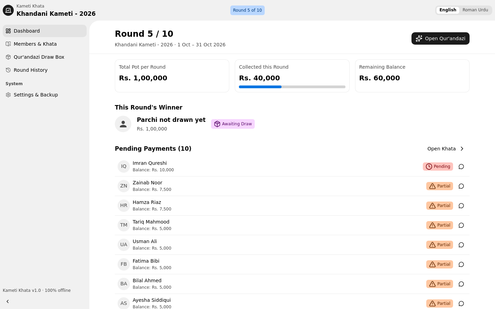

---

## Contents

- [What is a Kameti?](#what-is-a-kameti)
- [Features](#features)
- [Screenshots](#screenshots)
- [Install (Windows)](#install-windows)
- [Build from source](#build-from-source)
- [How to use](#how-to-use)
- [How the money is calculated](#how-the-money-is-calculated)
- [Fairness of the Qur'andazi](#fairness-of-the-quandazi)
- [Data, privacy and backups](#data-privacy-and-backups)
- [Project structure](#project-structure)
- [Design system notes](#design-system-notes)
- [Troubleshooting](#troubleshooting)
- [Roadmap ideas](#roadmap-ideas)

---

## What is a Kameti?

A **Kameti / BC (Ballot Committee)** is a rotating savings group common in Pakistan and South Asia.
Every member pays a fixed contribution each period. Each round, one member receives the whole pot. Who
receives it is decided by drawing folded paper slips (**parchis**) from a box, which is called **Qur'andazi**.
Once a member has received the pot their parchi is out ("Parchi Nikal Chuki"), but they keep paying until
everyone has had a turn.

Kameti Khata replaces the notebook (*khata*) and the paper slips with a transparent, offline desktop app.

## Features

### Committee setup
- 4-step **Setup Wizard**: title, organizer, members, installment amount (PKR), start date, Qur'andazi style.
- **Separate collection and payout intervals.** Members can pay **daily / weekly / monthly** and receive the
  pot **weekly / monthly**. Installments per round are auto-calculated (daily→weekly 7, daily→monthly 30,
  weekly→monthly 4, same interval 1) and editable.
- Auto-calculated **pot per round**, **amount each member pays per round**, **cycle duration** and **end date**.
- One active committee at a time, one share per member. Members can be added or removed **only before the first draw**.

### Dashboard
- Current round at a glance: **total pot**, **collected vs target** (progress bar), **remaining balance**.
- This round's winner and handover status.
- **Pending payments** list with one-click WhatsApp reminders.
- A single primary action that follows the round's lifecycle:
  **Open Qur'andazi → Hand over pot → Next round**.

### Members & Khata
- Every installment is a **one-click toggle**: green ✓ **Paid / Ada Ho Gaya**, amber 🕒 **Pending / Baqi**.
- Status per member: Paid / Partial / Pending.
- Payment mode: **Cash, EasyPaisa, JazzCash, Bank Transfer**, plus a free-text **note**.
- Filter by round, search by name or phone, show All / Pending / Paid.
- Member detail panel (a dialog on small windows) with **WhatsApp reminder / receipt** and **Save receipt (PNG)**.
- **Save round summary (PNG)** for the whole round.

### Qur'andazi Draw Box
- Animated glass **ballot box with folded parchis**, a shuffle animation, an optional **synthesised shuffle
  sound** (WebAudio, no audio files) and a winner reveal.
- **Round-by-round** draws or a **full-cycle upfront** draw (the whole payout sequence on day 1, revealed one by one).
- Winners are marked **"Pot Received / Parchi Nikal Chuki"** and excluded from later draws.
- Every draw needs confirmation and is **final, with no undo**.
- Live **payout sequence** panel.
- Respects *reduce motion* accessibility settings.

### Round History
- A table of every round: dates, winner, collected vs target, handover date and mode, status.
- A complete **activity log**: payments, draws, handovers, member changes, restores.

### Settings & Backup
- Committee details, **English / Roman Urdu**, currency symbol (`Rs.` / `₨`), **Large text** (senior-friendly), sound effects.
- **4-digit PIN lock** on launch, stored as a SHA-256 hash.
- **Export / Restore JSON backup**.
- **Start Fresh Committee** and **Reload Sample Data** (both ask for confirmation).

### Everything else
- Custom Windows **title bar** showing the committee name, round indicator, language toggle, lock button and window controls.
- **Collapsible sidebar**, responsive from compact windows (760 px) to ultra-wide screens (content is width-capped and centred).
- **South Asian number grouping**: `Rs. 1,00,000` (via `Intl.NumberFormat('en-IN')`).
- **Cycle completion ceremony** once every member has received the pot.
- Ships with the sample committee **"Khandani Kameti - 2026"** (10 members, rounds 1–4 completed) so you can try every screen immediately.

## Screenshots

| Members & Khata | Member detail |
| --- | --- |
| 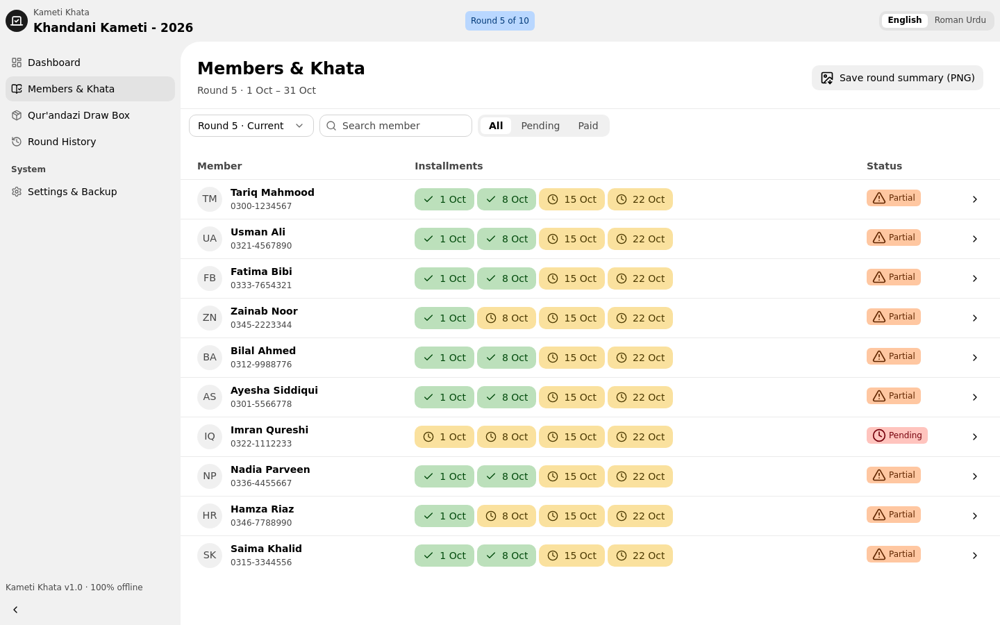 | 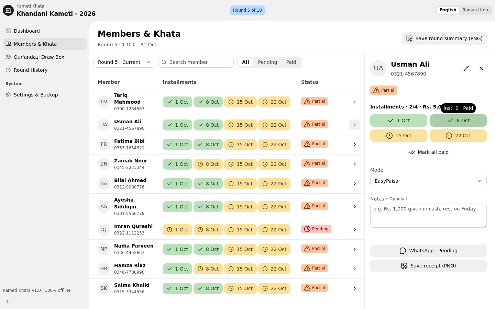 |

| Qur'andazi Draw Box | Winner reveal |
| --- | --- |
| 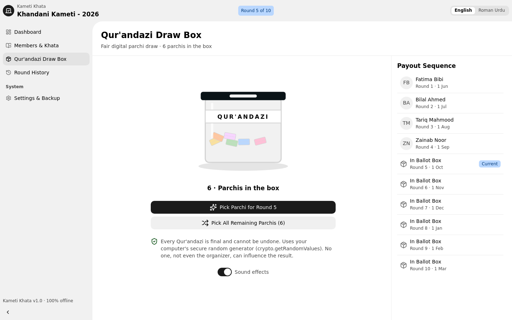 | 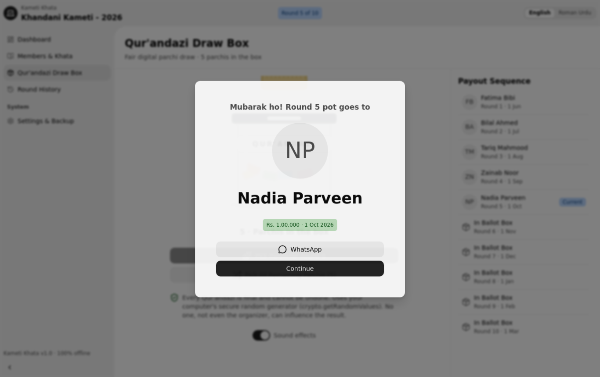 |

| Full-cycle draw | Round History |
| --- | --- |
| 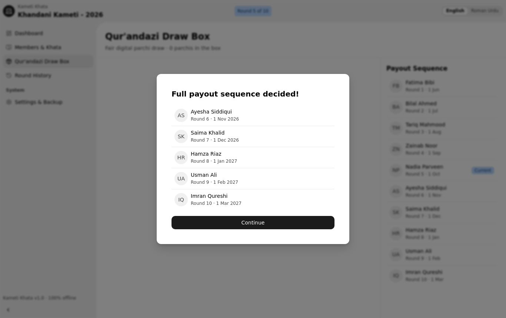 | 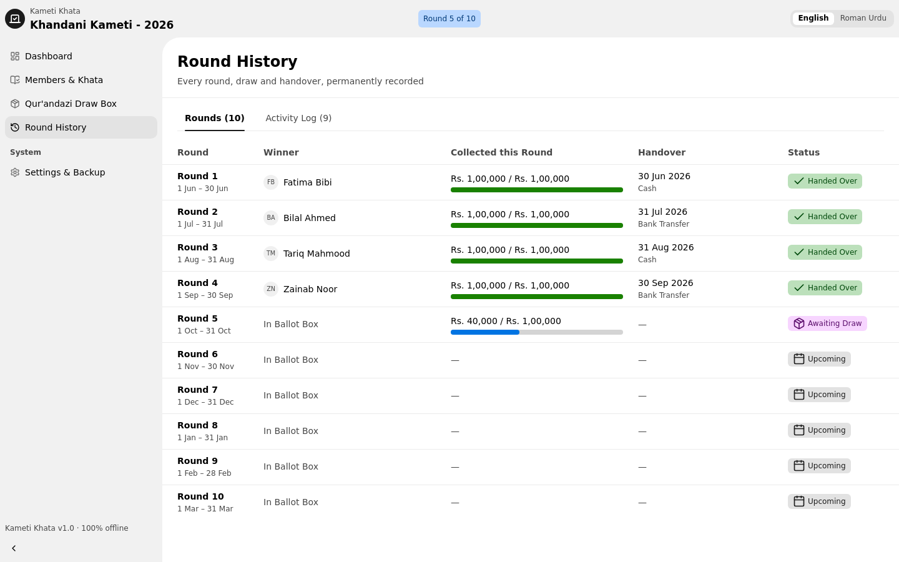 |

| Settings & Backup | Setup Wizard |
| --- | --- |
| 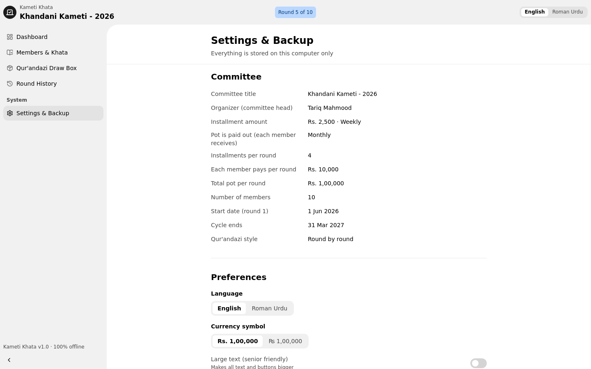 | 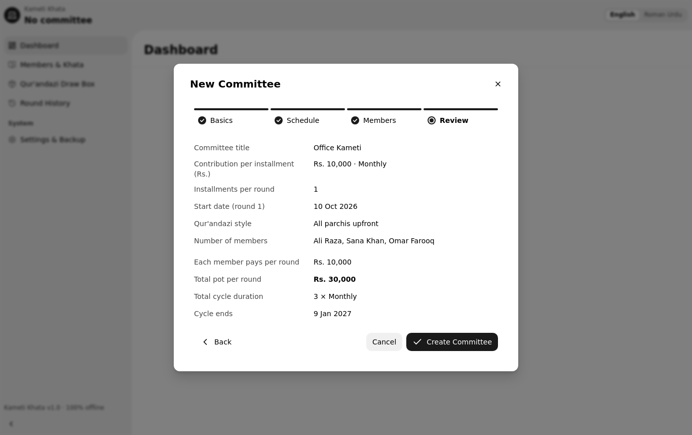 |

| PIN lock | Roman Urdu |
| --- | --- |
| 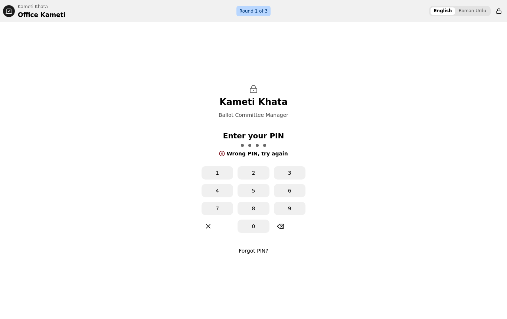 | 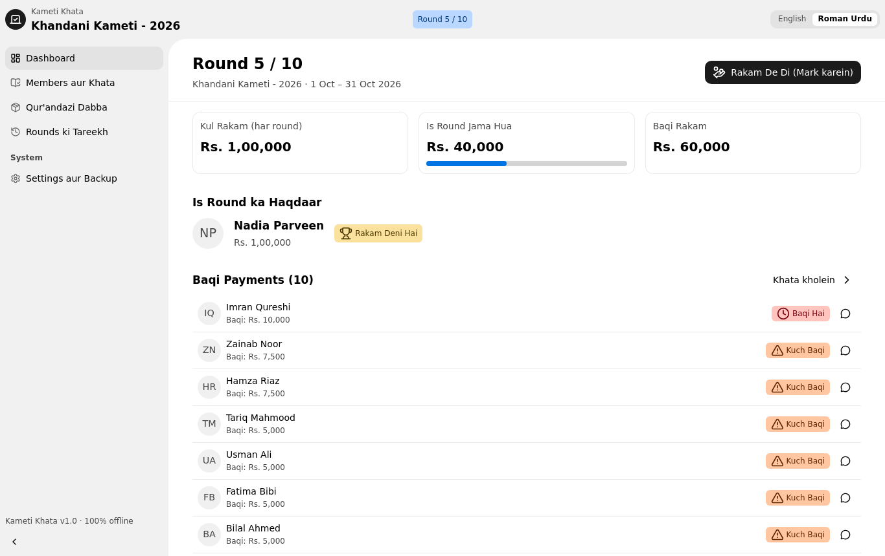 |

## Install (Windows)

1. Download the installer from the repository's **Releases** page (or [build it yourself](#build-from-source)):
   - `Kameti Khata_1.0.0_x64-setup.exe`: recommended. Installs per user, no admin rights needed.
   - `Kameti Khata_1.0.0_x64_en-US.msi`: for managed or IT installs.
2. Run it and open **Kameti Khata** from the Start menu.
3. The sample committee loads on first launch. When you're ready, go to **Settings & Backup → Start Fresh Committee**.

> **Windows SmartScreen:** unsigned installers can show "Windows protected your PC".
> Click **More info → Run anyway**. Code-sign the installer to remove this warning.

**Requirements:** Windows 10 (1803+) or Windows 11, x64. The app uses Microsoft Edge **WebView2**, which is
built into Windows 11 and updated Windows 10. See [Troubleshooting](#troubleshooting) for PCs that are never online.

## Build from source

### Prerequisites (Windows)

| Tool | Notes |
| --- | --- |
| [Node.js](https://nodejs.org) **22 LTS** | Node ≥ 20.19 builds the app; the Astryx CLI needs ≥ 22.13 |
| [Rust](https://rustup.rs) (stable, **MSVC** toolchain) | `rustup default stable-msvc` |
| [Visual Studio Build Tools](https://visualstudio.microsoft.com/visual-cpp-build-tools/) | Workload: **Desktop development with C++** |
| WebView2 | Already on Windows 10/11 |

See the official [Tauri prerequisites](https://v2.tauri.app/start/prerequisites/) if anything is missing.

### Commands

```bash
git clone https://github.com/S5SAJID/family-kamitee.git
cd family-kamitee
npm install

# Desktop app with hot reload
npm run desktop:dev

# Production installers (NSIS .exe + .msi)
npm run desktop:build
```

Installers are written to:

```
src-tauri/target/release/bundle/nsis/Kameti Khata_1.0.0_x64-setup.exe
src-tauri/target/release/bundle/msi/Kameti Khata_1.0.0_x64_en-US.msi
```

### Other scripts

| Script | What it does |
| --- | --- |
| `npm run dev` | Run the UI in a normal browser at http://localhost:1420 (window controls are hidden; files download instead of a Save dialog; WhatsApp opens in a new tab) |
| `npm run build` | Type-check and build the web assets into `dist/` |
| `npm run typecheck` | TypeScript only |
| `npm run preview` | Serve the built `dist/` |
| `npm run astryx -- <cmd>` | Astryx design-system CLI (component docs, templates, themes) |

### Changing the app icon

Edit `assets/app-icon.svg`, export it to a 1024×1024 PNG, then run:

```bash
npx tauri icon assets/app-icon.png
```

## How to use

1. **Create the committee.** Choose **Start Fresh Committee**, then fill in the wizard: title, member count,
   installment amount, how often members pay, how often the pot is paid out, start date, member names and
   phones (03xx…), and the Qur'andazi style.
2. **Draw the parchis.**
   - *Upfront* (default): open **Qur'andazi Draw Box → Pick All Remaining Parchis**. The full payout
     order is decided on day 1 and revealed one by one.
   - *Round by round*: pick one parchi at the start of each round.
3. **Collect installments.** In **Members & Khata**, click each installment chip when the money is received
   (green = paid). Set the payment mode, add notes, and send a WhatsApp receipt or reminder.
4. **Hand over the pot.** On the **Dashboard**, press **Hand over pot** and pick the payment mode.
5. **Next round.** Press **Next round** to move on. After the last handover, the **completion ceremony** appears.
6. **Back up regularly.** **Settings & Backup → Export Backup** saves a `.json` file. Keep a copy on a USB drive.

### WhatsApp messages

Reminders, receipts and winner announcements are pre-formatted in the current app language and opened
with a `https://wa.me/92XXXXXXXXXX?text=…` link. They open in WhatsApp Desktop if it is installed,
otherwise in the browser. Pakistani numbers like `0300-1234567` are converted to `923001234567` automatically.
Nothing is sent without you pressing **Send** in WhatsApp.

## How the money is calculated

```
installments per round = how many collection periods fit in one payout period (editable)
each member per round  = installment amount × installments per round
pot per round          = each member per round × number of members
cycle length           = number of members × payout interval
```

**Example (sample committee):** Rs. 2,500 weekly × 4 weeks = **Rs. 10,000** per member per month.
× 10 members = **Rs. 1,00,000** pot per month, over a **10-month** cycle.

There are deliberately no late fees, commission or partial amounts. Use the notes field for special cases.

## Fairness of the Qur'andazi

- Randomness comes from the operating system's **cryptographic RNG** (`crypto.getRandomValues`). It does not use `Math.random`.
- Single picks use **rejection sampling**, so every remaining member has exactly equal odds.
  Full-cycle draws use an unbiased **Fisher–Yates shuffle**.
- The result is **saved before the animation starts**, so closing the app mid-animation cannot re-roll a draw.
- Draws are **final**. There is no undo, and every draw is time-stamped in the activity log.
- The organizer cannot choose or influence the outcome.

Source: [`src/lib/calc.ts`](src/lib/calc.ts) (`secureRandomInt`, `secureShuffle`) and [`src/views/DrawBox.tsx`](src/views/DrawBox.tsx).

## Data, privacy and backups

- **No internet, no accounts, no telemetry.** There are no external fonts, CDNs or API calls. A strict
  Content-Security-Policy in [`src-tauri/tauri.conf.json`](src-tauri/tauri.conf.json) blocks remote content.
- All data is stored on the PC in the app's WebView **local storage** under the key `kameti-khata-v1`,
  inside your Windows user profile (`%LOCALAPPDATA%\com.kameti.khata\`).
- **Backups** are plain JSON: `{ "format": "kameti-khata-backup", "version": 1, "exportedAt": …, "data": { … } }`.
  Restores are validated before anything is replaced.
- **PIN:** only a SHA-256 hash is stored. There is **no PIN recovery**. *Forgot PIN* erases the data, and you
  then restore from your latest backup. The PIN stops casual access; it does not encrypt the data.
- Uninstalling may leave the data folder behind. Delete `%LOCALAPPDATA%\com.kameti.khata\` to remove it completely.

### Desktop permissions (Tauri capabilities)

The native side can only:
- minimize, maximize, close and drag the window;
- show a **Save As** dialog and write **the file you chose** (backups, PNG receipts);
- open `https://wa.me/*` and `whatsapp://*` links.

See [`src-tauri/capabilities/default.json`](src-tauri/capabilities/default.json).

## Project structure

```
├── assets/app-icon.svg            App icon source
├── docs/screenshots/              README images
├── index.html
├── src/
│   ├── main.tsx                   <Theme> provider (Astryx, light mode)
│   ├── App.tsx                    AppShell: title bar, sidebar, PIN gate, wizard, ceremony
│   ├── theme.ts                   defineTheme({ extends: Neutral }) + Windows system fonts
│   ├── astryx-themes.ts           GENERATED by `astryx theme add` (do not edit)
│   ├── styles/
│   │   ├── app.css                Token-based overrides (installment toggle colours)
│   │   └── offline-fonts.css      Replaces web-font imports: system fonts only
│   ├── views/
│   │   ├── Dashboard.tsx          Round overview + single lifecycle action
│   │   ├── Khata.tsx              Members table, installment toggles, detail panel
│   │   ├── DrawBox.tsx            Qur'andazi: confirm → shuffle → reveal
│   │   ├── History.tsx            Rounds table + activity log
│   │   └── Settings.tsx           Committee info, preferences, PIN, backup, danger zone
│   ├── components/
│   │   ├── TitleBar.tsx           Frameless-window header (drag, caption buttons)
│   │   ├── PageFrame.tsx          Shared Layout: header + content + optional panel, width caps
│   │   ├── BallotBox.tsx          SVG ballot box animated with the Web Animations API
│   │   ├── SetupWizard.tsx        4-step committee creation
│   │   ├── MemberDetail.tsx       Per-member khata panel
│   │   ├── MemberDialog.tsx       Add / edit / remove member
│   │   ├── InstallmentToggle.tsx  Paid / Pending one-click button
│   │   ├── PinPad.tsx · PinDialog.tsx · LockScreen.tsx
│   │   ├── CycleComplete.tsx      Completion ceremony
│   │   └── Status.tsx             Pay / round status tokens
│   └── lib/
│       ├── types.ts               Domain model
│       ├── store.ts               Zustand + persist (localStorage), backup validation
│       ├── calc.ts                Pot / round / date maths, secure random
│       ├── i18n.ts                English + Roman Urdu dictionary
│       ├── format.ts              Rs. 1,00,000 formatting, dates, phone → wa.me
│       ├── receipt.ts             Canvas-drawn PNG receipts & round summaries
│       ├── whatsapp.ts            Message templates
│       ├── sound.ts               WebAudio sound effects
│       ├── platform.ts            Tauri ↔ browser bridge (save file, open URL, window)
│       ├── sample.ts              "Khandani Kameti - 2026" sample data
│       └── hooks.ts               useT, useMoney, useData
└── src-tauri/
    ├── tauri.conf.json            Window, CSP, bundle (NSIS + MSI)
    ├── capabilities/default.json  Least-privilege permissions
    ├── Cargo.toml                 tauri + opener / dialog / fs plugins
    └── src/lib.rs                 Plugin registration
```

### Adding a translation string

Add the key to **both** the `en` and `ru` dictionaries in [`src/lib/i18n.ts`](src/lib/i18n.ts), then use
`const t = useT(); t('my.key', { n: 5 })`. Placeholders look like `{n}`.

## Design system notes

The UI is built entirely with **[Astryx](https://astryx.atmeta.com)** components and the **Neutral** theme:

- The theme is customised only through `defineTheme({ extends: themes[defaultThemeSlug] })`. The only
  change is the Windows system font stack (Segoe UI Variable), so no web fonts are needed.
- Pages are frame-first: `Layout` → `LayoutHeader` / `LayoutContent` / `LayoutPanel`, with one primary
  action per page. Dense data uses `Table` / `List` rows; `Card` is used only for KPI tiles and the danger zone.
- Width caps for wide screens are set in [`PageFrame.tsx`](src/components/PageFrame.tsx):
  forms 720 px · overview 1080 px · default 1200 px · table + panel 1360 px.
- Icons use Astryx semantic names (`check`, `clock`, `close`, …) or [lucide](https://lucide.dev) components
  passed directly, e.g. `<Icon icon={Wallet} />`.
- Colours come from semantic tokens and CSS variables. There are no hard-coded hex values in components.
- `AGENTS.md` and `theme.template.ts` were generated by `astryx init` and document the conventions.

## Troubleshooting

| Problem | Fix |
| --- | --- |
| **PC has never been online / WebView2 missing** | In `src-tauri/tauri.conf.json`, set `bundle.windows.webviewInstallMode.type` to `"offlineInstaller"` and rebuild. The installer grows by about 130 MB but needs no internet. |
| SmartScreen warning | Unsigned build. Choose *More info → Run anyway*, or code-sign the installer. |
| WhatsApp button does nothing | The member has no phone number, or neither WhatsApp Desktop nor a browser is set as the handler for `https` links. |
| Forgot PIN | Use *Forgot PIN?* on the lock screen (this erases data), then **Restore from Backup**. |
| `astryx` CLI says "requires Node.js >= 22.13" | Upgrade Node to 22 LTS. The app itself builds with Node 20.19+. |
| `cargo` / `link.exe` not found | Install Rust (MSVC) and the *Desktop development with C++* workload, then reopen the terminal. |
| Console warning about Astryx "runtime style injection" | Harmless. `astryx theme build` cannot yet pre-compile a theme that extends the generated Neutral module. |

## Roadmap ideas

- Multiple committees and multiple shares per member
- Printable PDF khata
- Encrypted backups / encrypted local store
- Automatic backup reminders
- Signed installers with an auto-updater

<!-- No licence chosen yet. Add a LICENSE file (e.g. MIT) if you want others to reuse this code. -->
