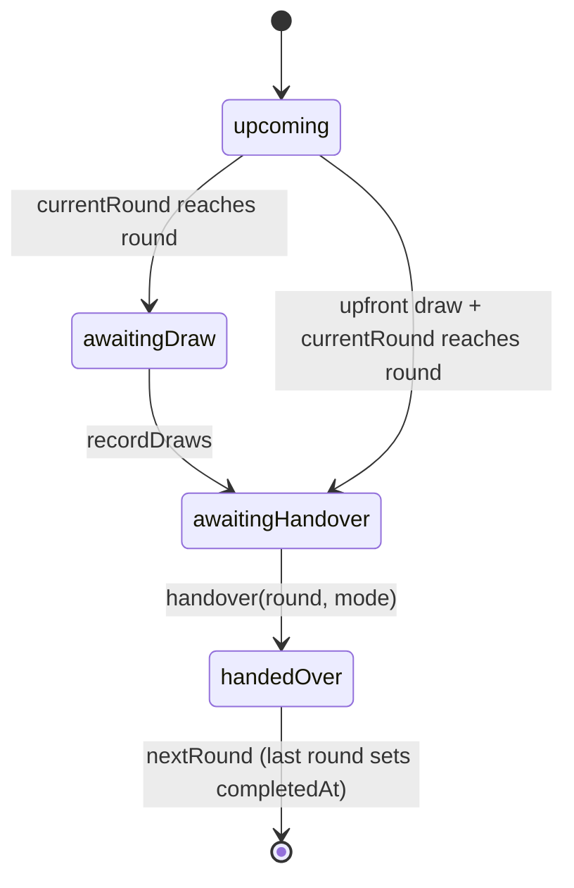

# Architecture

Offline, single-user desktop app. A Tauri 2 shell hosts a React SPA. All state lives in one Zustand
store persisted to `localStorage`. The Rust side does only three things: show a save dialog, write a
file the user chose, and open `wa.me` links.

## Layers

```
types.ts ─► format.ts ─► calc.ts ─► store.ts ─► hooks.ts ─► components/ ─► views/ ─► App.tsx
                                         ▲
              platform.ts · i18n.ts · receipt.ts · whatsapp.ts · sound.ts  (leaf services)
```

Imports only point **rightward / downward**. `src/lib/*` never imports React components.
`calc.ts` and `format.ts` are pure (no store, no DOM).

| Path | Owns |
| --- | --- |
| `lib/types.ts` | Domain model. The single source of truth for shapes. |
| `lib/calc.ts` | Pot/round/date maths, round status, eligibility, secure random. Pure. |
| `lib/format.ts` | Money (`en-IN` grouping), dates, `waNumber`, `uid`. Pure. |
| `lib/store.ts` | All state + every mutation (actions), persistence, backup validation. |
| `lib/hooks.ts` | `useT`, `useMoney`, `useData`. |
| `lib/i18n.ts` | `en` + `ru` dictionaries, `makeT`, `PAY_MODES`, interval lists. |
| `lib/platform.ts` | The only bridge to Tauri, with browser fallbacks. |
| `lib/receipt.ts` / `whatsapp.ts` / `sound.ts` | Canvas PNGs / message text + `wa.me` / WebAudio effects. |
| `components/` | Reusable UI with no page knowledge (`PageFrame`, `Status`, `BallotBox`, `PinPad`…). |
| `views/` | One file per sidebar page. Composes components and calls store actions. |
| `App.tsx` | Shell, PIN gate, view switch, global overlays (`SetupWizard`, `CycleComplete`). |

## Runtime flow

1. `main.tsx` loads the Astryx CSS → `app.css` → `<Theme theme={kametiTheme}>`.
2. `App`: if `settings.pinHash && !unlocked`, it renders `LockScreen` inside a bare `AppShell` (keeps the window controls).
3. Otherwise `AppShell` + `TitleBar` + `SideNav`. The page comes from `store.view` (no router: 5 fixed pages, no URLs in a desktop app).
4. `SetupWizard` (opened via `setupOpen`) and `CycleComplete` (shown when `completedAt && !celebrated`) are mounted globally.

## Domain model (`lib/types.ts`)

```
KametiData
├─ committee: Committee | null     contribution, collectionInterval, payoutInterval,
│                                  installmentsPerRound, startDate (YYYY-MM-DD), drawMode
├─ members: Member[]               {id, name, phone}, one share each
├─ draws: Draw[]                   {round, memberId, at, method}, sorted by round
├─ khata: Record<"round:memberId", KhataEntry>
│                                  paid: (PaidMark|null)[] (one slot per installment), mode, note
├─ rounds: Record<round, RoundMeta> handedOverAt, handoverMode
├─ currentRound, completedAt, celebrated
└─ log: LogEntry[]                 append-only audit trail
```

- Read khata **only** through `getEntry(data, round, memberId)`. It returns a default entry for missing keys
  and pads or trims `paid` when `installmentsPerRound` changes.
- A round has `members.length` rounds in total; round N pays out to `draws.find(d => d.round === N)`.

### Formulas (`calc.ts`)

```
perMemberPerRound = contribution × installmentsPerRound
potPerRound       = perMemberPerRound × members.length
roundStart(r)     = addInterval(startDate, payoutInterval, r - 1)
installmentDue    = addInterval(roundStart, collectionInterval, i)
```

`addInterval` clamps month ends (Jan 31 + 1 month = Feb 28). Dates in state are ISO strings; parse with
`parseISODate` (local date, never UTC-shifted).

### Round lifecycle



`roundStatus(data, round)` derives this; it is never stored.

## Invariants (enforced in store actions; never bypass)

| Invariant | Where |
| --- | --- |
| One draw per round, one round per member; existing draws are never overwritten | `recordDraws` filters |
| Draws are final: no undo action exists | by design |
| Draw result is persisted **before** the animation | `DrawBox.run` |
| Randomness only from `secureRandomInt` / `secureShuffle` (`crypto.getRandomValues`, rejection sampling, Fisher–Yates) | `calc.ts`, rule `no-math-random` |
| Single pick only for rounds ≤ `currentRound` | `DrawBox` `canPickOne` |
| Members can be added or removed only while `draws.length === 0` | `Khata`, `MemberDialog` |
| Past winners keep paying | `eligibleMembers` affects draws only |
| Handing over the last round sets `completedAt` + a `complete` log | `handover` |
| Every payment, draw, handover and member add/remove appends a `LogEntry` | actions in `store.ts` |
| No partial amounts, fees or commission: an installment is paid or not | `PaidMark \| null` |

## State management

- One store (`useStore`). Slices: **data** (`KametiData`), **settings**, **UI** (`view`, `setupOpen`, `unlocked`).
- Components subscribe with narrow selectors: `useStore(s => s.settings.sound)`. `useData()` returns the
  whole `KametiData` with shallow equality, so use it in views, not in tiny leaf components.
- Derived values (stats, status, eligibility) are computed with `calc.ts` at render time, never stored.
- Persistence: `persist` middleware, key `kameti-khata-v1`, `version: 1`, `partialize` (excludes `unlocked`,
  `setupOpen`), and `merge` deep-merges `settings` so new settings get defaults.

### Schema changes

Changing a persisted shape requires: bump `version`, add `migrate` in `store.ts`, make `importData` accept
old backups (spread over `emptyData()`), and update `isValidBackup` if required fields change.
Backups are `{format: 'kameti-khata-backup', version, exportedAt, data: KametiData}`.

## Platform bridge (`lib/platform.ts`)

| Function | Tauri | Browser fallback |
| --- | --- | --- |
| `isTauri()` | `__TAURI_INTERNALS__` present | false |
| `saveFile(name, blob, filter)` | dialog `save` + fs `writeFile` | anchor download |
| `pickTextFile()` | `<input type=file>` | same |
| `openExternal(url)` | opener `openUrl` | `window.open` |
| `windowControls.*` | window API | no-op |
| `sha256(text)` | WebCrypto | same |

Plugins are dynamically imported, so `npm run dev` runs in any browser.

## Security

- **CSP** (`tauri.conf.json`): `default-src 'self'`; inline styles are allowed (Astryx runtime theme); no remote origins.
- **Capabilities** (`capabilities/default.json`): window min/max/close/drag, `dialog:allow-save`,
  `fs:allow-write-file`, `opener:allow-open-url` limited to `https://wa.me/*` and `whatsapp://*`.
- **PIN**: SHA-256 hash in settings. It is an access gate, **not encryption**; data in `localStorage` is plaintext.
- **Backups**: `isValidBackup` is checked before `importData` replaces anything.

## Output generators

- `receipt.ts`: draws on a 2× canvas. Colours are read from CSS tokens via `getComputedStyle` (the hex values
  are fallbacks only). Saved through `saveFile`.
- `whatsapp.ts`: `buildMessage(kind, …)` uses `wa.*` i18n templates in the current language; `sendWhatsApp` → `wa.me`.
- `sound.ts`: synthesised (noise bursts + oscillators); always gated by `settings.sound`.

## Build & release

- `vite.config.ts`: `base: './'` (Tauri custom protocol), port 1420. The Neutral theme's Google `fonts.css` is
  aliased to `src/styles/offline-fonts.css`; `theme.ts` uses the Segoe UI system stack.
- Release profile: `lto = true`, `codegen-units = 1`, `strip` (small binaries, about 5 min to link in CI).
- `.github/workflows/ci.yml`: typecheck, rules, i18n, web build on push/PR.
- `.github/workflows/release.yml`: tag `v*` → `tauri-action` → NSIS + MSI on a GitHub Release.
  The tag must equal `version` in `src-tauri/tauri.conf.json`.
